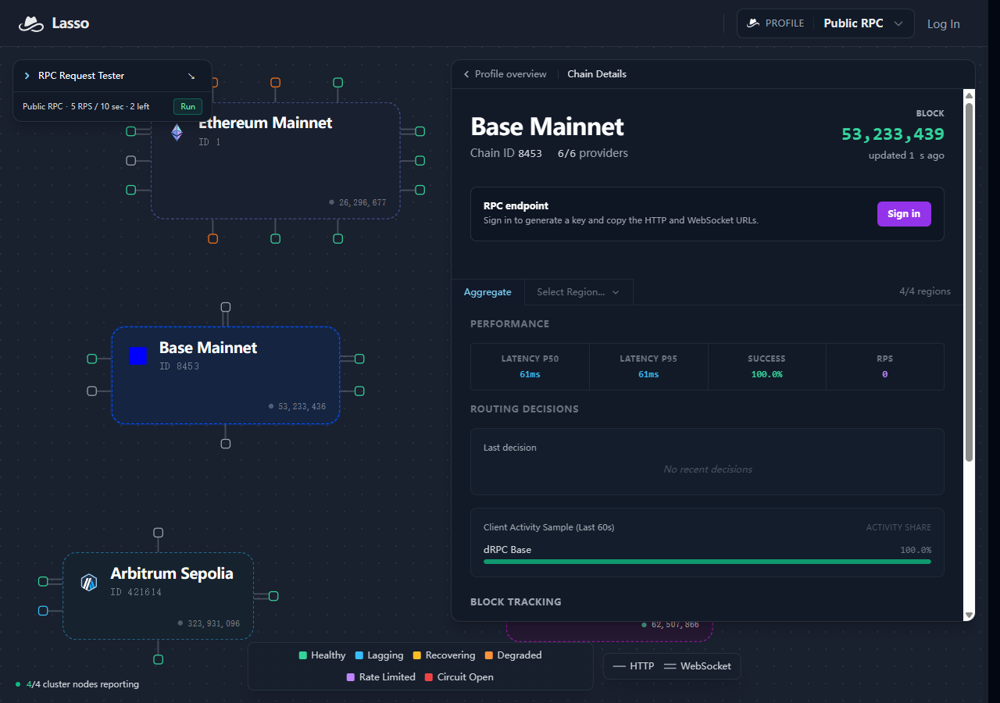

# Lasso feedback from a small on-chain work tracker

This is an entry for [poidh bounty 1515](https://poidh.xyz/base/bounty/1515). Any award or tip is discretionary. The requests and screenshot are from our own session.

GitHub: [zdfgu113](https://github.com/zdfgu113). X: [@jingsheng21578](https://x.com/jingsheng21578). A genuine earlier commit is [moshcoder/moshcode, 27 June 2026](https://github.com/moshcoder/moshcode/commit/cd2478163959499a7ce2cf82037d633183b3df64). Our existing work includes on-chain prototypes and tools that verify rewards with RPC reads.

## What we actually tried

We already use public BSC/Base RPC endpoints to check balances, bounty escrow and transaction receipts before recording any income. We created a Lasso key through its agent API, then used the public profile from that same workflow. No Lasso account funding or paid calls were needed.

On 2026-10-29T06:40:09.097Z, we compared Lasso public with https://mainnet.base.org at fixed Base block 53233278 (0x32c467e). Four methods, three samples per method/source, 24 requests in total. The order alternated between providers. The eth_call read poidh contract 0x5555Fa783936C260f77385b4E153B9725feF1719, bounty 529, which is the on-chain ID for this feedback bounty. Other reads checked chain ID, our wallet balance and contract code.

| Method | Lasso success | Lasso median / max ms | Base direct success | Base direct median / max ms | Identical result hashes |
|---|---|---|---|---|---|
| eth_chainId | 3/3 | 208 / 1566 | 3/3 | 446 / 1143 | true |
| eth_getBalance | 3/3 | 489 / 761 | 3/3 | 420 / 462 | true |
| eth_call | 3/3 | 420 / 470 | 3/3 | 431 / 433 | true |
| eth_getCode | 3/3 | 694 / 778 | 3/3 | 487 / 630 | true |

All 12 Lasso responses carried x-lasso-usd=0 and x-lasso-profile=public. For each method, successful responses matched byte-for-byte at the fixed block; [benchmark.json](benchmark.json) contains SHA-256 result hashes, HTTP results, elapsed times and safe request IDs. It contains no keys or credential-bearing URLs.

These are three samples per method, from one Windows environment. We observed mixed latency. eth_getCode was slower through Lasso in this run. eth_chainId was served locally, so its timing is not evidence of faster upstream routing. We did not test transaction submission or deliberately cause an upstream outage.

## What helped

The same JSON-RPC payload worked on both services. Per-request provider attribution and zero-cost headers made the free route auditable. Fixed-block comparisons let our tracker verify an escrow value without confusing provider lag with a balance change.

## Three concrete improvements

1. **Return a ready-to-use public URL in the key response.** The returned rpc_url used the premium route in our onboarding session; the free route required changing the profile path. The public path is documented, but an explicit public_rpc_url alongside premium_rpc_url would prevent an agent given a zero-spend budget from accidentally using its premium grant. Our actual trials used the public route and incurred zero RPC charge.

2. **Explain the agent account path beside the dashboard sign-in prompt.** We had already obtained a working agent key, while the public dashboard said “Sign in to generate a key and copy the HTTP and WebSocket URLs.” A link saying that agents can provision a key via the API, plus the account-claim/handoff instructions, would connect these two onboarding paths. We have not tested a human account-claim flow.

3. **Label the metric scope and sampling window at the numbers.** The screenshot shows public-profile Base P50/P95, RPS 0, “No recent decisions”, and a last-60-seconds activity share. I could not tell from that view which values describe probes, sampled public traffic or a particular client. The screenshot is a public dashboard, not a per-key usage page. A short scope label beside each metric, with a link to per-key request usage, would make it easier to reconcile it with request-level timings. I am reporting a UI interpretation problem, not proving that the counters are wrong.

## Would we use it?

Yes, as a second read source and a provider-attribution layer for the reward tracker. We would keep comparing fixed-block results and actual per-method latency before making it the default. This small sample does not establish a general speed or reliability advantage.

The open-source [jaxernst/lasso-rpc](https://github.com/jaxernst/lasso-rpc) repository has been starred from zdfgu113; GitHub returned HTTP 204 on the authenticated star check.

## Actual dashboard screenshot

Captured from https://lasso.sh/dashboard/public?chain=8453. No key or private dashboard was placed in this image.

